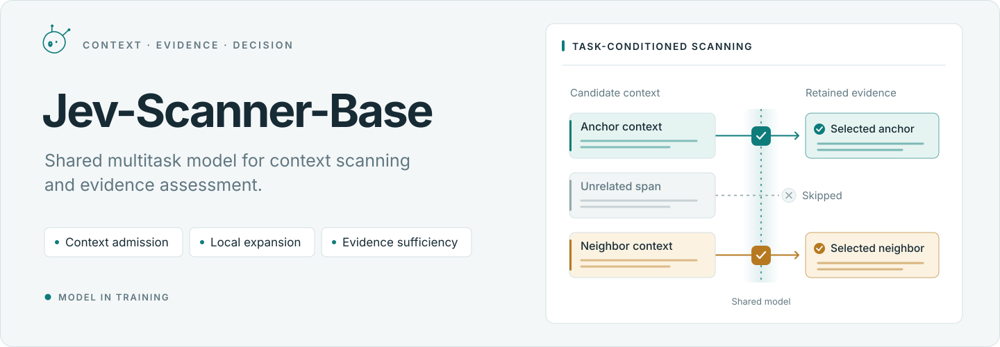
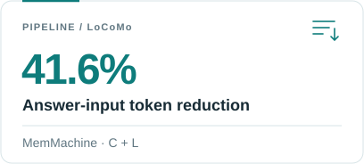
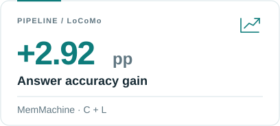
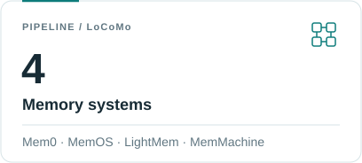
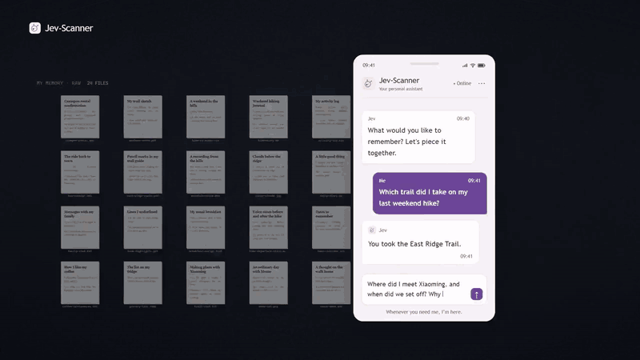
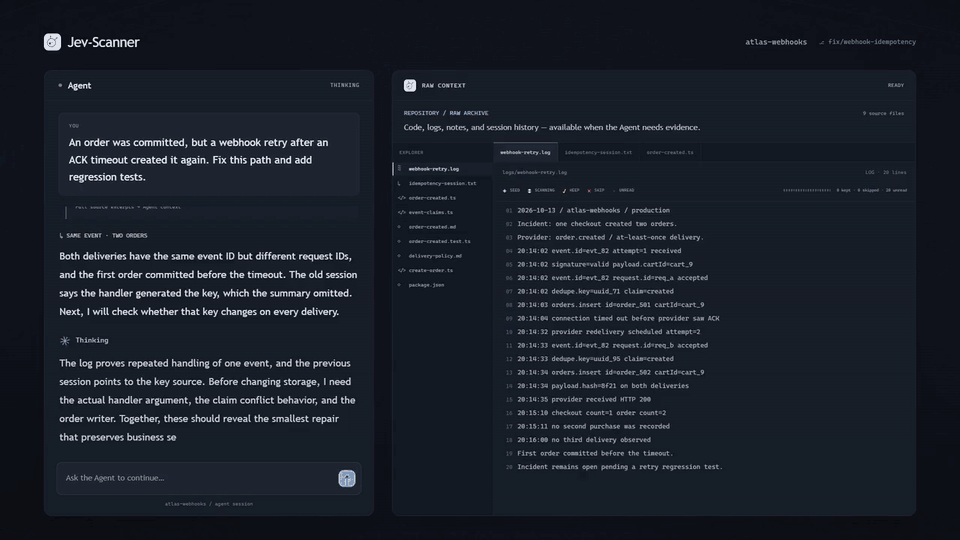
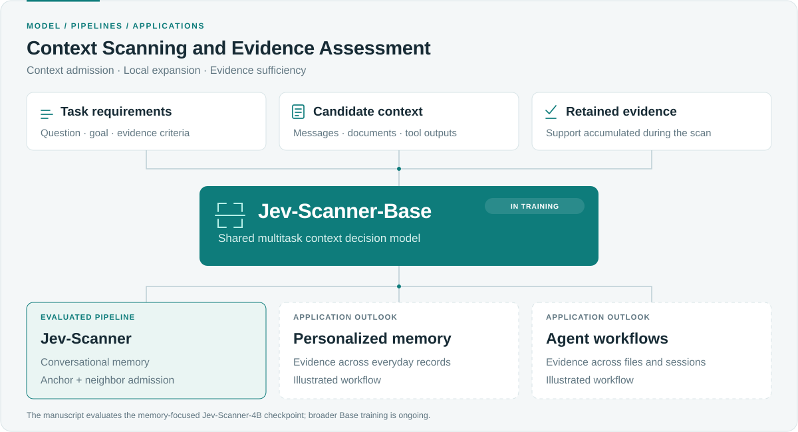
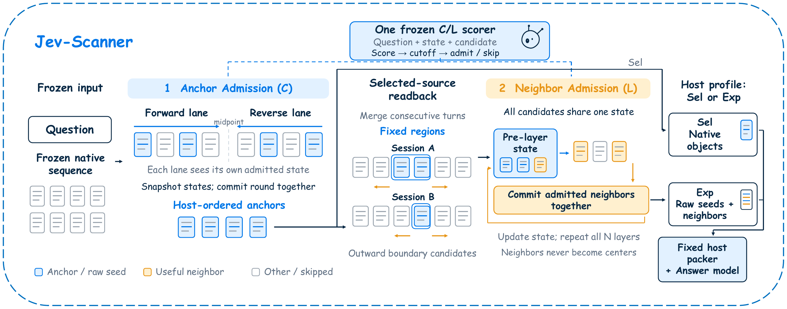
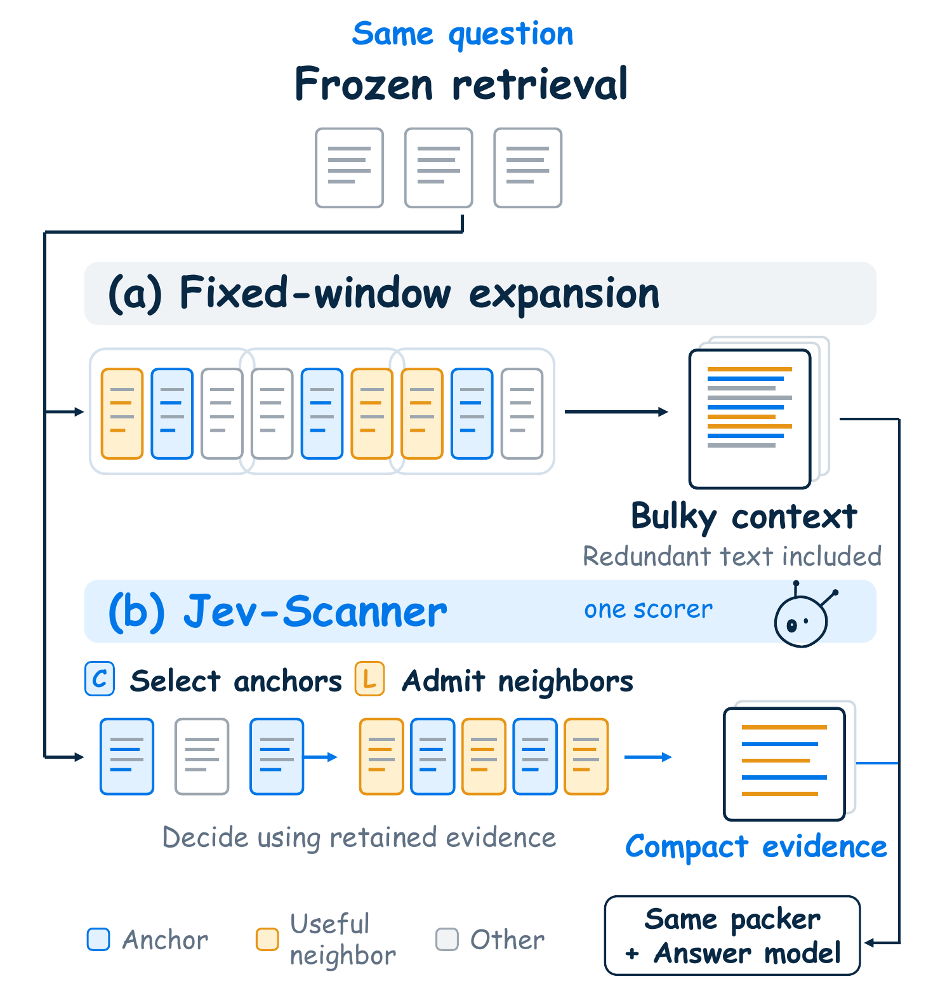

<p align="center">
  <picture>
    <source media="(max-width: 600px) and (prefers-color-scheme: dark)" srcset="assets/hero.en.mobile.dark.svg">
    <source media="(max-width: 600px)" srcset="assets/hero.en.mobile.svg">
    <source media="(prefers-color-scheme: dark)" srcset="assets/hero.en.dark.svg">
    
  </picture>
</p>

<p align="center">
  <strong>English</strong> · <a href="README.zh-CN.md">简体中文</a> &nbsp;&nbsp;
  <a href="#model"></a>
  <a href="#research"></a>
</p>

<p align="center">
  <a href="#applications">Applications</a> &nbsp;·&nbsp;
  <a href="#model">Model</a> &nbsp;·&nbsp;
  <a href="#research">Research</a> &nbsp;·&nbsp;
  <a href="#results">Results</a> &nbsp;·&nbsp;
  <a href="#next-steps">Next Steps</a> &nbsp;·&nbsp;
  <a href="#citation">Citation</a>
</p>

**Jev-Scanner-Base** is a shared multitask model for context scanning and evidence assessment.

Tasks include context admission, local evidence expansion, and evidence sufficiency assessment. **Jev-Scanner** is the model's pipeline application to long-term conversational memory. Multitask training is ongoing, with personalized memory and agent context management as application directions.

**Goals: faster inference, more accurate evidence assessment, and a better balance between input-token cost and answer quality.**

<p align="center">
  <picture>
    <source media="(prefers-color-scheme: dark)" srcset="assets/result-tokens.en.dark.svg">
    
  </picture>
  <picture>
    <source media="(prefers-color-scheme: dark)" srcset="assets/result-accuracy.en.dark.svg">
    
  </picture>
  <picture>
    <source media="(prefers-color-scheme: dark)" srcset="assets/result-hosts.en.dark.svg">
    
  </picture>
</p>

## Applications

Application scenarios.

### Personalized Memory

Evidence from chats, diaries, emails, and other personal records.

<p align="center">
  <a href="vidio/jev-scanner-en.gif"></a>
</p>

### Coding Agent

Evidence across logs, prior sessions, code, contracts, and tests for debugging.

<p align="center">
  <a href="vidio/jev-agent-en.gif"></a>
</p>

## Model

<p align="center">
  <a href="assets/overview.en.svg">
    <picture>
      <source media="(prefers-color-scheme: dark)" srcset="assets/overview.en.dark.svg">
      
    </picture>
  </a>
</p>

<details>
<summary>Tasks and target context sources</summary>

Inputs comprise task requirements, candidate context, and retained evidence.

| Task | Function | Status |
| --- | --- | --- |
| **Context admission** | Select candidates against task requirements and retained evidence | Evaluated in the memory pipeline |
| **Local expansion** | Select supporting evidence near anchors | Evaluated in the memory pipeline |
| **Evidence sufficiency** | Assess whether retained evidence meets task requirements | In development |

Target context sources: conversations, personal records, retrieved documents, tool outputs, code, logs, and execution traces.

</details>

## Research

**Jev-Scanner: Stateful Evidence Admission for Token-Efficient Long-Term Conversational Memory**

The paper evaluates the **Jev-Scanner-4B** checkpoint. After retrieval, the pipeline selects anchors and admits neighboring source evidence.

<p align="center">
  <a href="assets/paper-method.png"></a>
</p>

<p align="center"><sub>Figure 2. Shared scorer, anchor admission (C), and neighbor admission (L).</sub></p>

Selection-only hosts use C; source-expansion hosts use C + L. The pipeline preserves original evidence text and the host's answer format. Auxiliary evidence-sufficiency supervision is included in training and disabled during pipeline inference.

<p align="center">
  <a href="assets/paper-intro.png"></a>
</p>

<p align="center"><sub>Figure 1. Fixed-window expansion and Jev-Scanner under the same retrieval. Paper schematic.</sub></p>

## Results

### Memory and RAG Pipelines

LoCoMo results reported in the paper, covering four memory systems and HybridRAG:

| Host | Mode | Host accuracy (%) | Jev-Scanner (%) | Change (pp) | Answer-input token reduction |
| --- | --- | ---: | ---: | ---: | ---: |
| Mem0 | C | 89.16 | **89.16** | 0.00 | 3.8% |
| MemOS | C | 66.62 | **67.53** | +0.91 | 23.7% |
| LightMem | C | 72.01 | **73.44** | +1.43 | 21.0% |
| MemMachine | C | 81.88 | **82.14** | +0.26 | 8.5% |
| HybridRAG-Top-20 | C + L | 78.51 | **80.91** | **+2.40** | **40.7%** |
| MemMachine | C + L | 82.60 | **85.52** | **+2.92** | **41.6%** |

Accuracy measures LLM-judge acceptance. Main results cover 1,540 non-adversarial LoCoMo questions, including conversations used to construct supervision. A separate 314-question conversation-held-out slice is reported in the manuscript. Answer-input tokens exclude scanner and judge calls.

<details>
<summary>Admission model · Final SFT and backbone baselines</summary>

Final SFT models compared with their backbones before task fine-tuning:

| Checkpoint | C Acc. | C BA | C F1 | L Acc. | L BA | L F1 |
| --- | ---: | ---: | ---: | ---: | ---: | ---: |
| 4B · Backbone | 25.94 | 50.04 | 20.65 | 12.46 | 50.06 | 11.12 |
| **4B · Final SFT** | **85.19** | **78.96** | **79.98** | **92.25** | **77.07** | **80.05** |
| 0.8B · Backbone | 25.97 | 48.37 | 21.80 | 12.76 | 49.86 | 11.54 |
| **0.8B · Final SFT** | **82.22** | **74.37** | **75.57** | **89.80** | **69.00** | **72.18** |

All values are percentages, evaluated on held-out admission decision states. Acc.: decision accuracy; BA: balanced accuracy; F1: macro-F1. These metrics measure C/L admission decisions; the table above reports answer accuracy.

</details>

## Next Steps

- Expand multitask training across tasks and context sources.
- Evaluate evidence sufficiency and cross-application performance.
- Explore KV-cache reuse and inference optimizations to reduce repeated computation and scanning latency.

## Citation

```bibtex
@inproceedings{
anonymous2026jevscanner,
title={Jev-Scanner: Stateful Evidence Admission for Token-Efficient Long-Term Conversational Memory},
author={Anonymous},
booktitle={Submitted to ACL Rolling Review - October 2026},
year={2026},
url={https://openreview.net/forum?id=f78jBZe1oQ},
note={under review}
}
```
