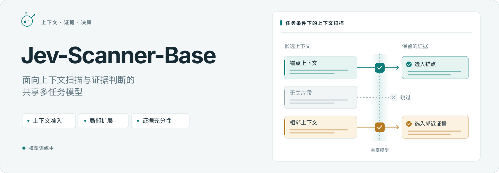
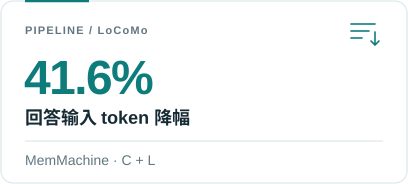
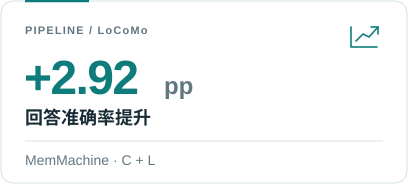
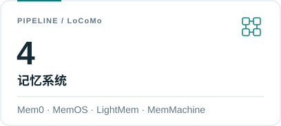
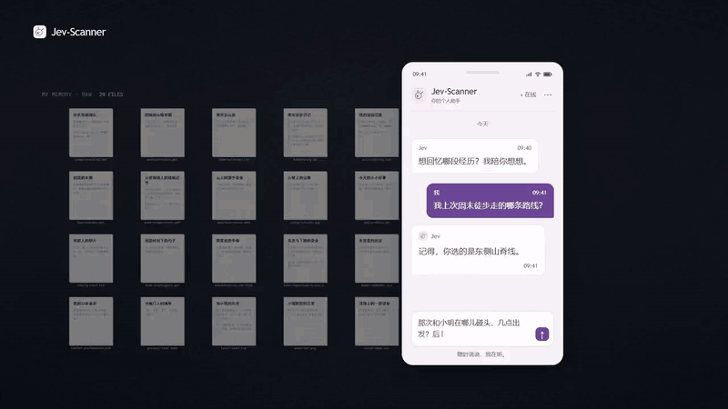
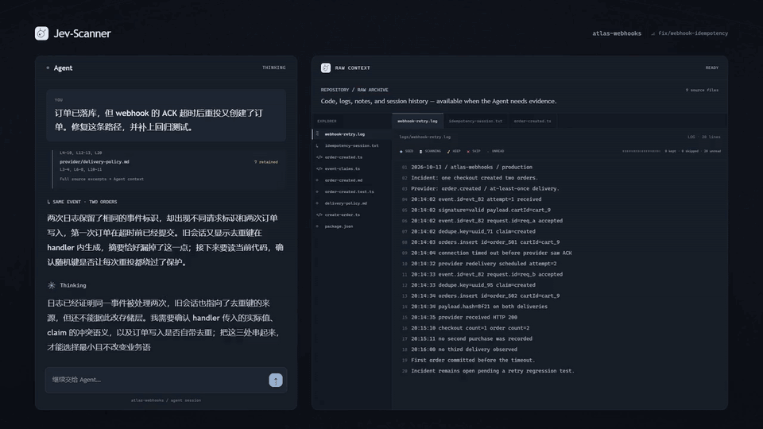
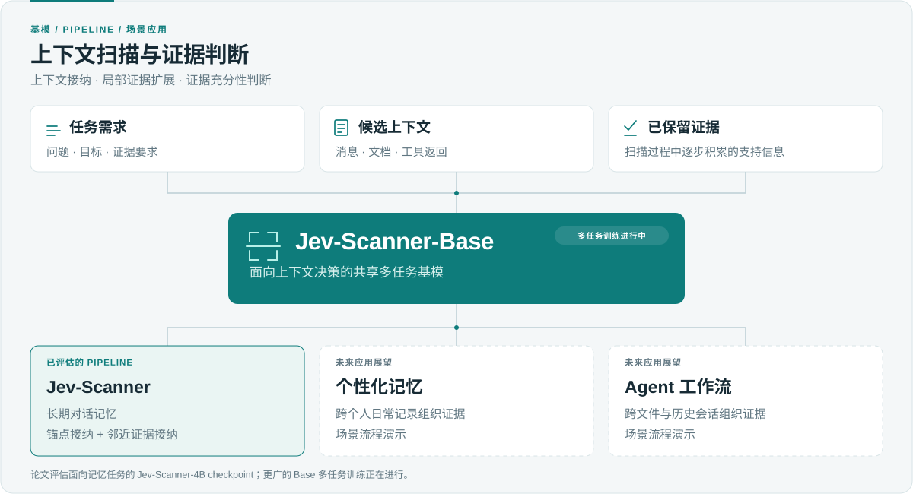

<p align="center">
  <picture>
    <source media="(max-width: 600px) and (prefers-color-scheme: dark)" srcset="assets/hero.zh-CN.mobile.dark.svg">
    <source media="(max-width: 600px)" srcset="assets/hero.zh-CN.mobile.svg">
    <source media="(prefers-color-scheme: dark)" srcset="assets/hero.zh-CN.dark.svg">
    
  </picture>
</p>

<p align="center">
  <a href="README.md">English</a> · <strong>简体中文</strong> &nbsp;&nbsp;
  <a href="#模型"></a>
  <a href="#论文"></a>
</p>

<p align="center">
  <a href="#场景">场景</a> ·
  <a href="#模型">模型</a> ·
  <a href="#论文">论文</a> ·
  <a href="#结果">结果</a> ·
  <a href="#后续工作">后续工作</a> ·
  <a href="#引用">引用</a>
</p>

**Jev-Scanner-Base** 是一个面向上下文扫描与证据判断的共享多任务模型。

任务包括上下文接纳、局部证据扩展与证据充分性判断。**Jev-Scanner** 是该模型在长期对话记忆中的 pipeline 应用。多任务训练持续进行，应用方向包括个性化记忆与 Agent 上下文管理。

**目标：更快的推理、更准的证据判断，平衡输入 token 开销与回答质量。**

<p align="center">
  <picture>
    <source media="(prefers-color-scheme: dark)" srcset="assets/result-tokens.zh-CN.dark.svg">
    
  </picture>
  <picture>
    <source media="(prefers-color-scheme: dark)" srcset="assets/result-accuracy.zh-CN.dark.svg">
    
  </picture>
  <picture>
    <source media="(prefers-color-scheme: dark)" srcset="assets/result-hosts.zh-CN.dark.svg">
    
  </picture>
</p>

## 场景

应用场景。

### 个性化记忆

从聊天、日记、邮件等个人记录中整理证据。

<p align="center">
  <a href="vidio/jev-scanner-zh.gif"></a>
</p>

### Coding Agent

跨日志、历史会话、协议、代码与测试获取证据，辅助调试。

<p align="center">
  <a href="vidio/jev-agent-zh.gif"></a>
</p>

## 模型

<p align="center">
  <a href="assets/overview.zh-CN.svg">
    <picture>
      <source media="(prefers-color-scheme: dark)" srcset="assets/overview.zh-CN.dark.svg">
      
    </picture>
  </a>
</p>

<details>
<summary>任务与上下文类型</summary>

输入包括任务需求、候选上下文与已保留的证据。

| 任务 | 功能 | 进展 |
| --- | --- | --- |
| 上下文接纳 | 根据任务与已有证据筛选候选内容 | 已在记忆 pipeline 中验证 |
| 局部证据扩展 | 从锚点附近选择补充证据 | 已在记忆 pipeline 中验证 |
| 证据充分性判断 | 判断当前证据是否满足任务需求 | 开发中 |

上下文覆盖方向：对话历史、个人记录、检索文档、工具返回、代码、日志与执行轨迹。

</details>

## 论文

**Jev-Scanner: Stateful Evidence Admission for Token-Efficient Long-Term Conversational Memory**

论文采用 **Jev-Scanner-4B** checkpoint。pipeline 在检索后执行锚点接纳与邻近证据接纳。

<p align="center"><a href="assets/paper-method.png"></a></p>

<p align="center"><sub>图 2：共享 scorer 执行锚点接纳（C）与邻近证据接纳（L）。</sub></p>

仅筛选的宿主执行 C，支持来源扩展的宿主执行 C + L。pipeline 保留证据原文与宿主回答格式。论文 checkpoint 包含充分性辅助监督，该任务在 pipeline 推理时关闭。

<p align="center"><a href="assets/paper-intro.png"></a></p>

<p align="center"><sub>图 1：同一检索输入下，固定窗口扩展与 Jev-Scanner 的对比。论文示意图。</sub></p>

## 结果

### 记忆与 RAG pipeline

论文报告的 LoCoMo 结果，覆盖四个记忆系统与 HybridRAG：

| 宿主 | 模式 | 原始准确率（%） | Jev-Scanner（%） | 变化（百分点） | 回答输入 token 降幅 |
| --- | --- | ---: | ---: | ---: | ---: |
| Mem0 | C | 89.16 | 89.16 | 0.00 | 3.8% |
| MemOS | C | 66.62 | 67.53 | +0.91 | 23.7% |
| LightMem | C | 72.01 | 73.44 | +1.43 | 21.0% |
| MemMachine | C | 81.88 | 82.14 | +0.26 | 8.5% |
| HybridRAG-Top-20 | C + L | 78.51 | 80.91 | +2.40 | 40.7% |
| MemMachine | C + L | 82.60 | 85.52 | +2.92 | 41.6% |

评测集包含 1,540 个非对抗问题，涵盖用于监督数据构建的训练对话；论文另报告 314 个按对话留出的问题。准确率由 LLM 评判器判定。回答输入 token 不包括 Scanner 与评判器调用。

<details>
<summary>准入模型 · 最终 SFT 与骨干对比</summary>

论文中最终 SFT 模型与任务微调前骨干的对比：

| Checkpoint | C Acc | C BA | C macro-F1 | L Acc | L BA | L macro-F1 |
| --- | ---: | ---: | ---: | ---: | ---: | ---: |
| 4B · 骨干（未微调） | 25.94 | 50.04 | 20.65 | 12.46 | 50.06 | 11.12 |
| 4B · 最终 SFT | 85.19 | 78.96 | 79.98 | 92.25 | 77.07 | 80.05 |
| 0.8B · 骨干（未微调） | 25.97 | 48.37 | 21.80 | 12.76 | 49.86 | 11.54 |
| 0.8B · 最终 SFT | 82.22 | 74.37 | 75.57 | 89.80 | 69.00 | 72.18 |

指标单位均为百分比，按留出的准入决策状态评估。Acc 为决策准确率，BA 为平衡准确率，macro-F1 为宏平均 F1；这些指标衡量 C/L 准入决策，与上表的回答准确率不同。

</details>

## 后续工作

- 扩展多任务训练与上下文类型。
- 完成证据充分性与跨场景评估。
- 探索 KV-cache 复用与推理优化，减少重复计算，降低扫描延迟。

## 引用

```bibtex
@inproceedings{
anonymous2026jevscanner,
title={Jev-Scanner: Stateful Evidence Admission for Token-Efficient Long-Term Conversational Memory},
author={Anonymous},
booktitle={Submitted to ACL Rolling Review - October 2026},
year={2026},
url={https://openreview.net/forum?id=f78jBZe1oQ},
note={under review}
}
```
